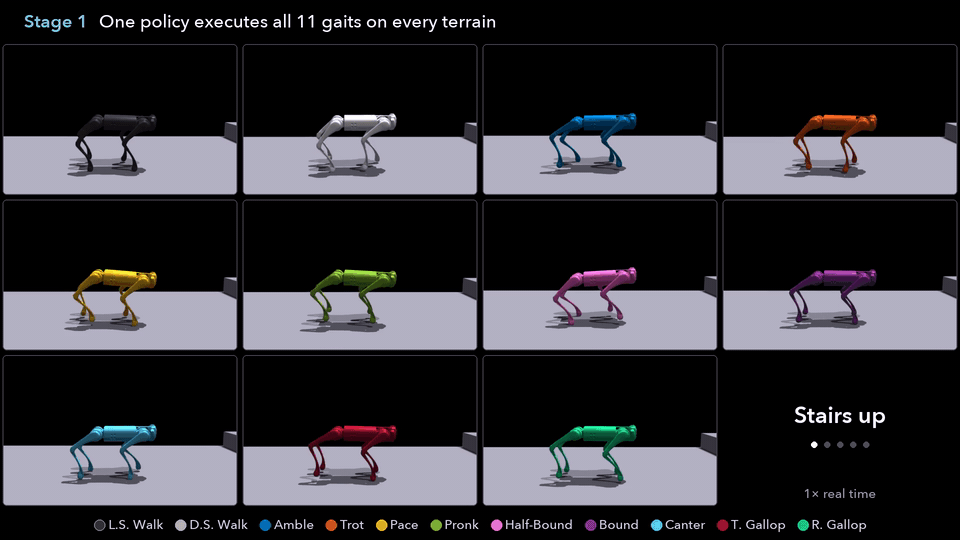
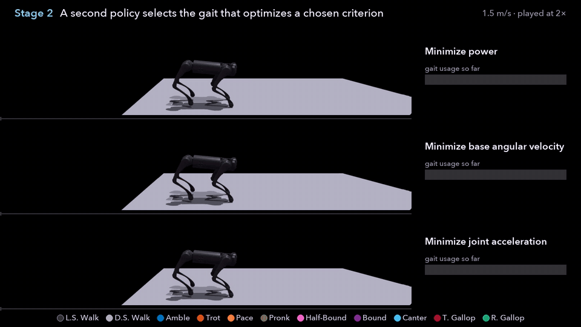
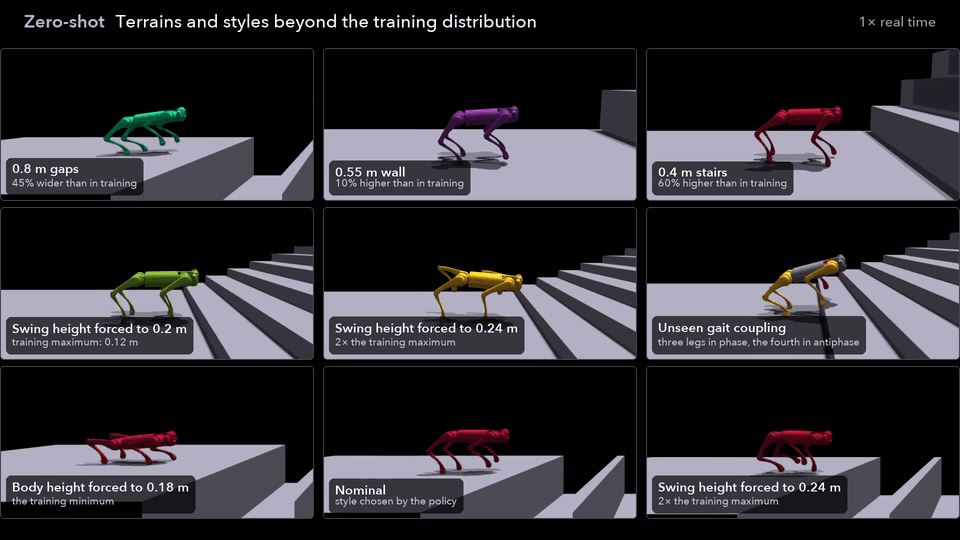
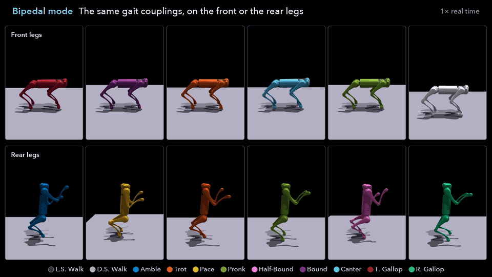

# Learning optimal gaits and styles for terrain-adaptive quadruped locomotion

[Guillaume Bellegarda](https://guillaume10.github.io)<sup>1,2</sup>, [Auke Ijspeert](https://www.epfl.ch/labs/biorob/people/ijspeert/)<sup>2</sup>
<br><sup>1</sup>Inria, <sup>2</sup>EPFL

[](https://arxiv.org/abs/2611.25958)
[](https://guillaume10.github.io/terrain-gaits)
[](LICENSE)
[](https://developer.nvidia.com/isaac-gym)

Official code for the paper, built on NVIDIA Isaac Gym. With it you can:
- **Train one policy for all 11 gaits** (Stage 1): from walk to gallop, on slopes, stairs, gaps, rough terrain, and mixed blocks.
- **Train a gait selector** (Stage 2) on top of it, which selects gaits to optimize a criterion of your choice, such as energy efficiency or stability.
- **Train bipedal locomotion** on the front or rear legs with the same gait couplings.
- **Run the pretrained policies from the paper**, including on the parkour course.




## Installation ##
0. You will need a NVIDIA GPU with at least 5GB GPU memory. 
1. Create a new python virtual env with python 3.8 (required by `numpy==1.23.5`)
2. Install pytorch and tensorboard and the correct version of setuptools:
    - `pip install numpy==1.23.5 protobuf==4.25.0` (>=1.24 creates np.float error, >=5.25 creates tensorboard error)
    - `pip install torch torchvision torchaudio --index-url https://download.pytorch.org/whl/cu118`
    - `pip install tensorboard`
    - `pip install setuptools==59.5.0`
3. Install Isaac Gym
   - Download and install Isaac Gym Preview 3 or 4 from https://developer.nvidia.com/isaac-gym
   - `cd isaacgym/python && pip install -e .`
   - Try running an example `cd examples && python 1080_balls_of_solitude.py`
   - For troubleshooting check docs `isaacgym/docs/index.html`
4. Install rsl_rl (PPO implementation)
   - Clone https://github.com/leggedrobotics/rsl_rl.git
   -  `cd rsl_rl && git checkout v1.0.2 && pip install -e .` 
5. Install
    - Clone this repository
   - `cd cpg-rl && pip install -e .`

## Code Structure ##
1. The stage 1 environment is defined by an env file (`quadruped_gaits.py`) and a config file (`quadruped_gaits_config.py`). The config file contains two classes: one with all the environment parameters (`QuadrupedGaitsCfg`) and one for the training parameters (`QuadrupedGaitsCfgPPO`).
2. The stage 2 environment is defined by an env file (`quadruped_gait_selector.py`) and a config file (`quadruped_gait_selector_config.py`). The config file contains two classes: one with all the environment parameters (`QuadrupedGaitSelectorCfg`) and one for the training parameters (`QuadrupedGaitSelectorCfgPPO`). This `cfg` file importantly should point to the path of a NN trained in stage 1 in `pretrained`.   
3. These tasks are registered using `task_registry.register(name, EnvClass, EnvConfig, TrainConfig)` in `envs/__init__.py`.

## Usage ##
1. Train stage 1 (learning all of the gaits on all of the terrains) 
    
    ```python cpg_gym/scripts/train.py --task=quadruped_gaits --max_iterations=100000 --headless```
    - The trained policy is saved in `<log_root>/logs/<experiment_name>/<date_time>_<run_name>/model_<iteration>.pt`. Where `<experiment_name>` and `<run_name>` are defined in the train config.
    - NOTE: train handstand locomotion by setting `HANDSTAND = 1` (front legs) or `2` (rear legs) at the top of `quadruped_gaits_config.py`.
2. Play a stage 1 trained policy:  

    ```python cpg_gym/scripts/play.py --task=quadruped_gaits  --num_envs=20  --log_root=<log_root>/quadruped_gaits --load_run=<load_directory_name>```   
    - By default the loaded policy is the last model of the last run of the experiment folder.
    - Other runs/model iteration can be selected by setting `load_run` and `checkpoint` in the train config.
3. Train a stage 2 policy (learn the optimal gait based on specific criteria such as energy efficiency, or stability, etc.): 

    ```python cpg_gym/scripts/train.py --task=quadruped_gait_selector --max_iterations=2000 --headless```
    - Note: replace the path in `pretrained` of `QuadrupedGaitSelectorCfg` with the NN location trained in stage 1. 
    - Change the minimal reward function depending on the metric you would like to optimize (i.e. energy, stability, etc.)
    - Setting the `PARKOUR` flag at the top of `quadruped_gait_selector_config.py` tests the parkour environment in the paper. 
4. Play a stage 2 trained policy:  

    ```python cpg_gym/scripts/play.py --task=quadruped_gait_selector  --num_envs=20   --log_root=<log_root>/quadruped_gait_selector --load_run=<load_directory_name>```
5. We provide pretrained policies from the paper in `resources/models`. The stage 2 selector is best visualized with the `PARKOUR` flag in `quadruped_gait_selector_config.py`:  
    ```python cpg_gym/scripts/play.py --task=quadruped_gaits  --num_envs=1  --log_root=resources/models --load_run=stage1```
    
    ```python cpg_gym/scripts/play.py --task=quadruped_gait_selector  --num_envs=1   --log_root=resources/models --load_run=stage2_energy```

## More results ##



## Data ##
The source data behind the paper's quantitative figures (Main Fig 3, Fig 4, and
Supplementary Figs 2-12) is in [`data/`](data/) — five CSV files with a
full column dictionary in [`data/README.md`](data/README.md).

## Acknowledgements ##
- This code builds on [legged_gym](https://github.com/leggedrobotics/legged_gym) (ETH Zurich and NVIDIA): the environment structure, task registry, terrain generation, and training and play scripts are adapted from it (see `LICENSES/legged_gym_license.txt`).
- Policies are trained with the PPO implementation of [rsl_rl](https://github.com/leggedrobotics/rsl_rl).
- Simulation runs on [NVIDIA Isaac Gym](https://developer.nvidia.com/isaac-gym).
- The Go1 and Go2 models are from [Unitree Robotics](https://github.com/unitreerobotics/unitree_ros) (BSD-3-Clause).

## Citation ##
If you use this code, please cite:
```bibtex
@article{bellegarda2026terrain,
  title   = {Learning optimal gaits and styles for terrain-adaptive quadruped locomotion},
  author  = {Bellegarda, Guillaume and Ijspeert, Auke},
  year    = {2026},
  eprint  = {2611.25958},
  archivePrefix = {arXiv},
}
```
